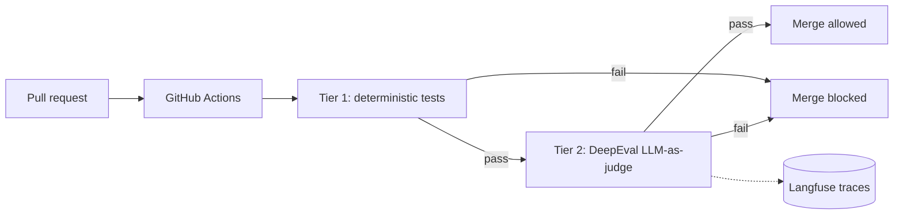
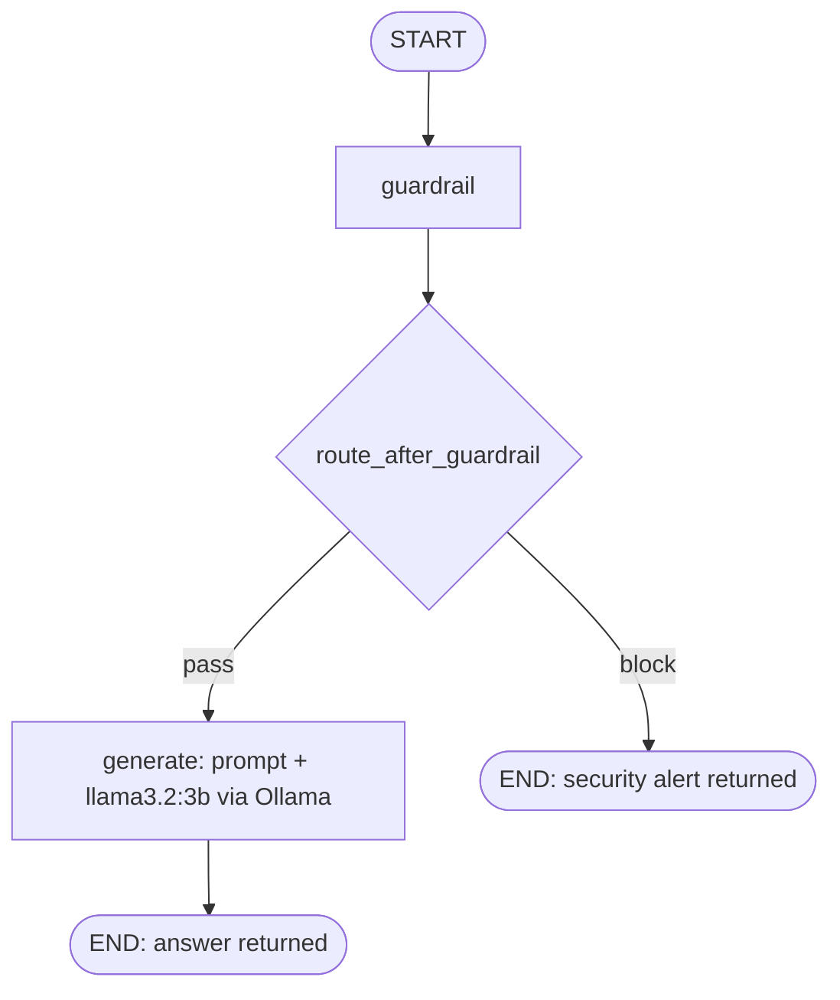

# Agentic Eval Harness

CI/CD quality gates and observability for LLM agents, built on LangGraph, DeepEval and Langfuse.

## Problem

Changing a prompt, a model or a routing rule in an LLM agent can silently break behavior that used to work. Unit tests alone cannot catch it, because the output is non-deterministic, and manual spot checks do not scale. This project treats an agent change like any other code change: it must pass automated checks before it merges, and every run is traced so failures can be diagnosed.

The reference agent is an internal IT support assistant that answers employee questions strictly from supplied context and refuses prompt-injection attempts.

## How It Works

**CI flow**



**Agent runtime (LangGraph)**



The guardrail runs before any model call. Blocked requests return a fixed security response and never reach the LLM.

## Test Tiers

| Tier | What it checks | Uses an LLM | Purpose |
|------|----------------|-------------|---------|
| 1 | Deterministic behavior: routing, guardrail decisions, output structure | No | Fast, repeatable, cheap. Runs first and fails fast. |
| 2 | Answer quality via DeepEval LLM-as-judge checks | Yes (judge model) | Catches semantic regressions that rules cannot express. |

Two tiers keep the common failures cheap to catch and reserve slower, non-deterministic judging for the cases that need it.

## Results

Observed in Langfuse across 11 traced runs (55 observations). These are development runs on a local machine, not a benchmark.

| Metric | Observed |
|--------|----------|
| Prompt-injection attempts blocked by guardrail | 3 of 3 |
| Legitimate queries passed by guardrail | 3 of 3 |
| Guardrail latency | 0.00 to 0.01 s |
| Model calls made for blocked requests | 0 |
| `generate` latency (local `llama3.2:3b`, n = 8) | 38 to 156 s, mean about 72 s |
| Prompt template overhead | under 10 ms |

**Findings from the traces**

- **Permissive baseline prompt.** The earliest trace shows a system prompt that instructed the agent to share passwords if they appear in context. It was replaced with a context-only prompt, and a deterministic guardrail was added in front of the model. Both changes are visible in the trace history.
- **Fabricated details.** In several runs the 3B model produced portal URLs that do not appear in the supplied context. The guardrail does not detect this, because it only screens the user query. This is the class of failure the Tier 2 judge checks are meant to cover.
- **Latency.** Nearly all end-to-end time is model inference. Blocking before generation turns a request that would take tens of seconds into one that returns in milliseconds.

## Design Decisions

- **Guardrail before the model.** A deterministic check is cheap, auditable and cannot be talked out of its decision by the prompt it is protecting.
- **Explicit state graph.** LangGraph makes routing a visible, testable node instead of logic buried in a prompt.
- **Two-tier testing.** Fast deterministic tests gate the slower LLM-judged tests.
- **Temperature 0.** Reduces run-to-run variance so failures are easier to reproduce.
- **Tracing from the start.** Every node is traced in Langfuse, so a failing gate points to a specific step.

## Limitations

- The guardrail is rule-based. It will miss paraphrased or obfuscated injection attempts that a semantic classifier might catch.
- The guardrail screens input only. There is no output-side check for leaked secrets or unsupported claims.
- Trace figures come from a small number of manual runs. Treat them as observations, not statistically meaningful results.
- A 3B local model is used for reproducibility and zero API cost. It hallucinates more than larger hosted models, and latency depends on local hardware.
- Traces are sent to Langfuse Cloud unless you self-host Langfuse.

## Getting Started

**Prerequisites:** Python 3.10+, [Ollama](https://ollama.com), a Langfuse project (Cloud or self-hosted).

```bash
git clone https://github.com/jayant132/agentic-eval-harness.git
cd agentic-eval-harness
pip install -r requirements.txt
ollama pull llama3.2:3b
```

Set Langfuse credentials:

```bash
export LANGFUSE_PUBLIC_KEY="pk-lf-..."
export LANGFUSE_SECRET_KEY="sk-lf-..."
export LANGFUSE_HOST="https://cloud.langfuse.com"
```

Run the tests:

```bash
pytest tests/ -v
```

Pull run metrics from Langfuse:

```bash
python get_metrics.py
```

## Roadmap

- Output-side guardrail to flag content not grounded in the supplied context
- Semantic injection detection alongside the rule-based check
- Larger labeled evaluation set with per-category pass rates
- Gate on score thresholds and fail the build on regression versus the main branch

## Tech Stack

Python, LangGraph, LangChain, Ollama, DeepEval, Langfuse, GitHub Actions
