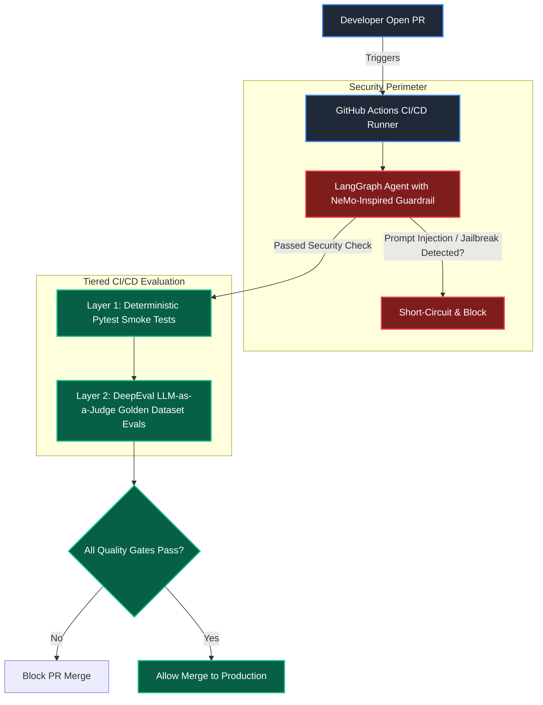

# Agentic CI/CD Evaluation & Observability Harness (`agentic-eval-harness`)

[](https://www.python.org/)
[](https://github.com/langchain-ai/langgraph)
[](https://github.com/confident-ai/deepeval)
[](https://langfuse.com/)
[-informational.svg)](https://ollama.com/)
[](https://github.com/astral-sh/uv)

A production-grade, privacy-first **LLMOps framework** designed to treat agentic AI prompts, workflows, and tools like compiled code. This repository bridges the gap between prototype AI and enterprise reliability by implementing pre-execution security guardrails, a tiered testing architecture, and real-time runtime observability.

---

## 🏗️ System Architecture & Workflow

In enterprise AI engineering, updating an agent's system prompt or underlying tool graph without automated evaluation introduces silent regressions. This project implements a **dual-layer MLOps architecture**: pre-execution threat blocking, offline CI/CD quality gates, and online distributed tracing.



---

## 🛠️ Production Tech Stack

* **Orchestration:** **LangGraph** for managing stateful agent loops, context passing, and node transitions.
* **Security Perimeter:** Pre-execution validation nodes inspired by **NeMo Guardrails** to intercept prompt injections.
* **Local Execution & Judge:** **Ollama** running `llama3.2:3b` for zero-cost, data-private inference.
* **Evaluation Framework:** **DeepEval** and **Pytest** running a **Tiered Testing Strategy** (Fast smoke checks + Deep LLM-as-a-Judge regression tests).
* **Runtime Observability:** **Langfuse** capturing OpenTelemetry traces, token usage, and latencies across stateful runs.
* **Infrastructure Management:** Astral **`uv`** for lightning-fast dependency resolution and virtual environment creation.

---

## 📂 Project Structure

```text
agentic-eval-harness/
├── agents/
│   ├── __init__.py
│   └── support_agent.py      # LangGraph stateful agent + NeMo guardrails + Langfuse telemetry
├── tests/
│   ├── __init__.py
│   ├── test_data.json        # Golden dataset (Inputs, Contexts, Expected Outputs)
│   ├── custom_judge.py       # Custom DeepEval base LLM routing to Ollama JSON mode
│   ├── test_smoke.py         # LAYER 1: Fast deterministic Python assertions & guardrail checks
│   └── test_eval.py          # LAYER 2: Deep semantic LLM-as-a-Judge hallucination/relevancy evals
├── .github/
│   └── workflows/
│       └── eval.yml          # Automated GitHub Actions CI/CD pipeline running tiered tests
├── .env                      # Secure runtime keys (git-ignored)
├── pyproject.toml
├── requirements.txt
└── README.md

```

---

## 🚀 Quickstart & Local Installation

### Prerequisites

1. Ensure [Ollama](https://ollama.com/) is installed and running locally:
```bash
ollama pull llama3.2:3b

```


2. Create a free account on [Langfuse](https://cloud.langfuse.com) to get your API keys.

### Step-by-Step Setup

1. **Clone the repository:**
```bash
git clone [https://github.com/jayant132/agentic-eval-harness.git](https://github.com/jayant132/agentic-eval-harness.git)
cd agentic-eval-harness

```


2. **Initialize environment using `uv`:**
```bash
uv venv
source .venv/bin/activate

```


3. **Install dependencies:**
```bash
uv pip install langgraph langchain-ollama deepeval pytest python-dotenv langfuse langchain nemoguardrails
uv pip freeze > requirements.txt

```


4. **Configure Environment Secrets:**
Create a `.env` file in the root directory:
```env
LANGFUSE_PUBLIC_KEY=lf-pk-your_public_key_here
LANGFUSE_SECRET_KEY=lf-sk-your_secret_key_here
LANGFUSE_HOST=[https://cloud.langfuse.com](https://cloud.langfuse.com)

```


5. **Run the Tiered Testing Suite Locally:**
```bash
# Run Layer 1: Fast Smoke & Security Tests
pytest tests/test_smoke.py -v

# Run Layer 2: Deep Semantic Evaluation Harness
deepeval test run tests/test_eval.py

```


---

## 💡 Key Engineering Takeaways for MNC Recruiter Evaluation

* **Tiered Testing Strategy:** Combines fast programmatic smoke checks (`test_smoke.py`) for instantaneous PR feedback with deep semantic LLM-as-a-Judge evaluations (`test_eval.py`) to prevent behavioral regressions.
* **Pre-Execution Security Perimeter:** Implements a threat-blocking node inspired by *NeMo Guardrails* inside LangGraph to short-circuit malicious inputs before incurring LLM compute costs.
* **Complete Air-Gapped Privacy & $0 Cost:** Local model execution via Ollama ensures zero third-party API token expenses and guarantees sensitive documentation never leaves internal hardware during testing.

---

## 👨‍💻 Author

Built and maintained by an AI Engineer focused on building robust, secure, observable, and reliable enterprise-grade autonomous systems.